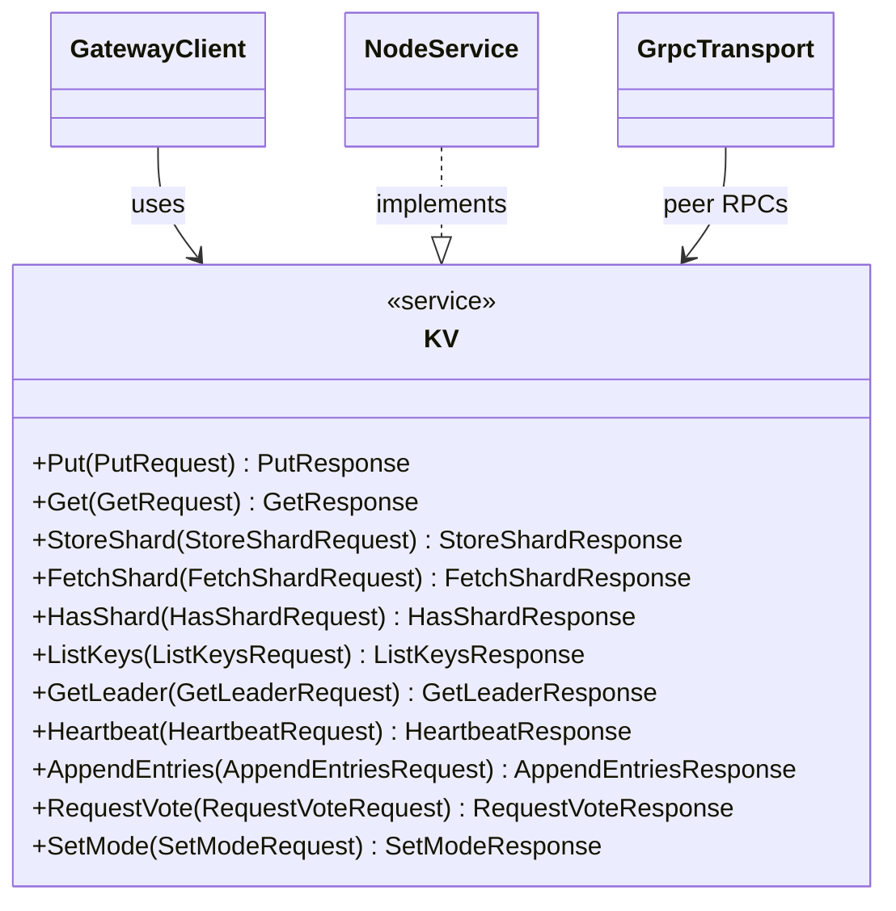

# API Reference

Maps to **transparency** (single endpoint) and **openness/extensibility**
(clean, typed interface). The contract is defined in `proto/kv.proto` and
generated into `gen/`.

## Service class diagram



## RPCs

| RPC | Direction | Purpose |
|---|---|---|
| `Put` | client → leader | Encode + store 5 shards + Raft commit metadata |
| `Get` | client → leader | Fetch shards + reconstruct + verify + read repair |
| `StoreShard` | leader → node | Persist one shard locally |
| `FetchShard` | leader → node | Read one shard |
| `HasShard` | leader/repair → node | Shard presence check |
| `ListKeys` | sync/sweep → node | Metadata key list |
| `GetLeader` | gateway → node | Leader id, degraded list, mode, term, key_count |
| `Heartbeat` | leader → node | Liveness + degraded reporting |
| `AppendEntries` | leader → node | Raft log replication |
| `RequestVote` | candidate → node | Raft election |
| `SetMode` | client → leader | Toggle `rs32` / `replication` |

## Key messages

| Message | Fields |
|---|---|
| `PutRequest` | `key`, `value` (bytes), `mode` |
| `PutResponse` | `ok`, `error`, `version` |
| `GetRequest` | `key` |
| `GetResponse` | `value` (bytes), `found`, `error`, `version` |
| `GetLeaderResponse` | `leader`, `degraded[]`, `mode`, `term`, `key_count` |
| `HeartbeatResponse` | `ok`, `leader`, `degraded[]`, `mode`, `term` |
| `RaftLogEntry` | `term`, `index`, `type`, `payload` |
| `AppendEntriesRequest` | `term`, `leader_id`, `prev_log_index`, `prev_log_term`, `entries[]`, `leader_commit` |
| `RequestVoteRequest` | `term`, `candidate_id`, `last_log_index`, `last_log_term` |

## Gateway CLI

```sh
docker compose run --rm gateway status
docker compose run --rm gateway put <key> <value> [--mode rs32|replication]
docker compose run --rm gateway get <key>
docker compose run --rm gateway mode <rs32|replication>
```

Output is JSON:

```json
{"ok": true, "version": 1}
{"found": true, "value": "hello"}
{"leader": "node2", "degraded": [], "mode": "rs32", "key_count": 1}
{"ok": true, "mode": "replication"}
```

## Where the code lives

- Contract: `proto/kv.proto`
- Generated: `gen/kv_pb2.py`, `gen/kv_pb2_grpc.py`, `scripts/gen_proto.sh`
- Server: `node/service.py::NodeService`
- Gateway: `gateway/client.py::GatewayClient`, `gateway/main.py::main`
- Peer transport: `node/transport.py::GrpcTransport`

## Verified by

- `tests/test_node_grpc.py::test_store_fetch_has_roundtrip`
- `tests/test_gateway_leader.py::test_leader_failover_rediscovery`
- `scripts/smoke.sh`
