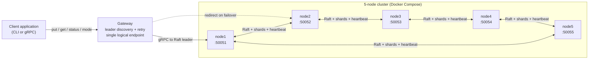
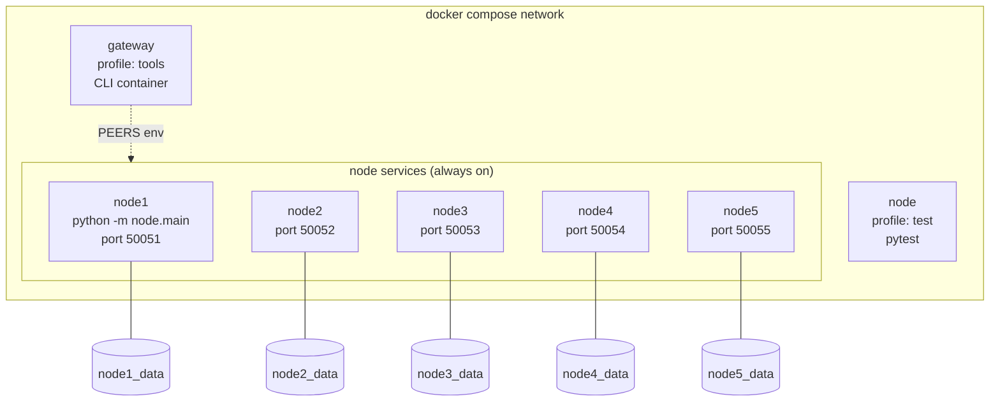

# Architecture

This document describes the system decomposition, deployment topology, and the
mapping to the course's **functional separation**, **transparency**, and
**heterogeneity** principles.

## System context

## Docker deployment topology

## Module map

| Layer | Package / file | Responsibility |
|---|---|---|
| Client entry | `gateway/main.py` | CLI parsing, JSON output |
| Client logic | `gateway/client.py` | Leader discovery, retry, put/get/status/mode |
| Routing | `gateway/ring.py` | Consistent-hash ring (150 vnodes/node) |
| RPC contract | `proto/kv.proto`, `gen/` | Protobuf messages + generated stubs |
| Node service | `node/service.py` | `NodeService` implements the KV RPCs |
| Auth | `node/auth.py` | `AuthInterceptor` shared-token check |
| Transport | `node/transport.py` | `GrpcTransport` peer RPCs with token metadata |
| Consensus facade | `node/raft/node.py` | `RaftNode` composes the mixins |
| Election | `node/raft/election.py` | `RaftElection` |
| Replication | `node/raft/replication.py` | `RaftReplication` |
| Persistence/FSM | `node/raft/persistence.py` | `RaftPersistence` |
| Failure detection | `node/raft/failure_detector.py` | `RaftFailureDetector` |
| Redundancy | `node/encode.py` | `RS32Engine`, `ReplicationEngine`, `checksum` |
| Repair | `node/repair.py` | `read_repair`, `RepairSweeper`, `sync_on_start` |
| Storage | `node/storage.py` | `Storage` over SQLite (WAL) |
| Logging | `node/logging.py` | Structured JSON, redaction |
| Startup | `node/main.py` | Wire storage + raft + server + sweeper + sync |

## Why this satisfies the principles

- **Functional separation** — each concern has its own module/class (see table).
- **Transparency** — only the gateway is exposed to clients; topology is hidden.
- **Heterogeneity** — gRPC/Protobuf over HTTP/2; language-agnostic contract.

## Where the code lives

- Compose services/ports/volumes: `docker-compose.yml`
- Server bootstrap: `node/main.py::main`
- gRPC server assembly: `node/server.py::serve`
- Service implementation: `node/service.py::NodeService`

## Verified by

- `tests/test_node_grpc.py::test_store_fetch_has_roundtrip`
- `docker compose ps` → all five nodes `(healthy)`
- `scripts/smoke.sh` → end-to-end cluster smoke
