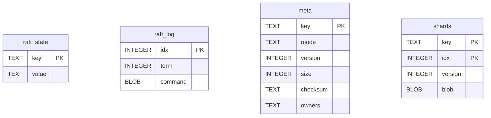

# Data Model (SQLite)

Maps to the proposal's **Local Persistence Store (SQLite3)** and the course's
**reliability** and **inherent distribution** principles. Each node owns one
SQLite file under its Docker volume (`/data/<node>.db`).

## Entity-relationship diagram



The tables are independent (no FK) because each is a durable log/index; the
logical link is `meta.key = shards.key` and `meta.owners[idx]`.

## Table purposes

| Table | Purpose | Written by |
|---|---|---|
| `raft_state` | `current_term`, `voted_for`, `commit_index`, `default_mode` | `RaftPersistence._persist_state` |
| `raft_log` | Append-only Raft log (`idx`, `term`, `command`) | `RaftPersistence._persist_append`, `_persist_truncate` |
| `meta` | Per-key metadata: mode, version, size, SHA-256, owner list (JSON) | FSM `_default_apply` (`op=put`) |
| `shards` | One encoded fragment per `(key, idx)` | `Storage.store_shard` / `NodeService.StoreShard` |

## Example rows

```text
raft_state: ("current_term","7"), ("voted_for","node2"), ("commit_index","12"), ("default_mode","rs32")

raft_log: (1, 1, '{"op":"put","key":"demo","mode":"rs32",...}')

meta: ("demo","rs32",3,11,"2cf24dba...","[""node1"",""node2"",""node3"",""node4"",""node5""]")

shards: ("demo",0,3,<D1 bytes>), ("demo",1,3,<D2 bytes>), ..., ("demo",4,3,<P2 bytes>)
```

## Durability & concurrency

- SQLite opened with `check_same_thread=False`, `timeout=30.0`, WAL journal.
- A `threading.RLock` guards every public `Storage` method.
- Schema is created with `CREATE TABLE IF NOT EXISTS` (idempotent on reopen).
- Data survives container restarts because the DB lives in a named volume.

## Where the code lives

- Schema + connection: `node/storage.py::_SCHEMA`, `Storage.__init__`
- Raft state/log helpers: `Storage.get_raft_state`, `set_raft_state`,
  `append_log`, `get_log`, `get_log_from`, `truncate_log`, `last_log`
- Metadata: `Storage.upsert_meta`, `get_meta`, `list_meta_keys`
- Shards: `Storage.store_shard`, `fetch_shard`, `has_shard`, `delete_shard`,
  `list_for_node`

## Verified by

- `tests/test_storage.py::test_schema_idempotent`
- `tests/test_storage.py::test_reopen_durability`
- `tests/test_storage.py::test_concurrent_writes`
- `tests/test_raft_persistence.py::test_state_and_log_roundtrip`
- `tests/test_raft_persistence.py::test_truncation_matches_storage`
