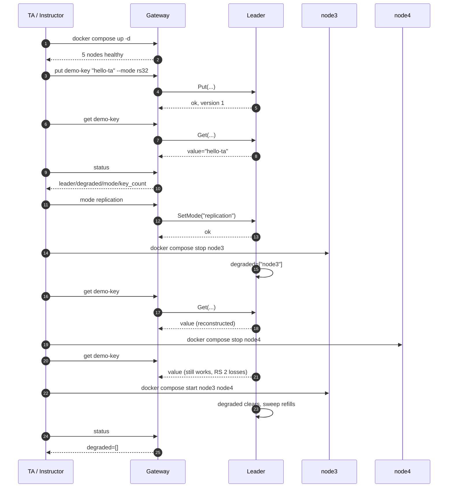

# Demo

The demo lives in [`scripts/demo.sh`](../scripts/demo.sh); the automated
assertions live in [`scripts/smoke.sh`](../scripts/smoke.sh). This document
describes the same flow so it can be followed manually or used for the final
report.

## Demo sequence



## Commands

```sh
# 1. Cluster
docker compose up -d
docker compose ps

# 2. Write + read (RS 3+2)
docker compose run --rm gateway put demo-key "hello-ta" --mode rs32
docker compose run --rm gateway get demo-key

# 3. Status
docker compose run --rm gateway status

# 4. Toggle mode
docker compose run --rm gateway mode replication
docker compose run --rm gateway put demo2 "hello-repl"
docker compose run --rm gateway get demo2

# 5. Fault tolerance
docker compose stop node3
docker compose run --rm gateway get demo-key
docker compose stop node4
docker compose run --rm gateway get demo-key

# 6. Recovery
docker compose start node3 node4
sleep 12
docker compose run --rm gateway status

# 7. Teardown
docker compose down -v
```

## Core features

| Feature | Behaviour | Code |
|---|---|---|
| Leader election | Randomized 150–300ms timeout → RequestVote → majority (3/5) | `node/raft/election.py` |
| Leader failover | New election within ~1s; gateway rediscovers | `gateway/client.py::discover_leader` |
| RS(3,2) erasure coding | 3 data + 2 parity; any 3 reconstruct; 1 error correctable | `node/encode.py::RS32Engine` |
| 5× replication | One copy/node; survives 4 losses; any 1 reconstructs | `node/encode.py::ReplicationEngine` |
| Per-key mode | `PutRequest.mode` override or cluster default; mixed modes coexist | `node/service.py::Put` |
| Write commit | All 5 shard acks, then Raft metadata commit on quorum | `node/service.py::Put`, `node/raft/replication.py` |
| Read + verify | Parallel FetchShard, decode, size + SHA-256 check | `node/service.py::Get` |
| Read repair | Canonical re-encode, background StoreShard for mismatches | `node/repair.py::read_repair` |
| Repair sweep | Every 10s, refill missing shards across all keys | `node/repair.py::RepairSweeper` |
| Startup sync | Returning node pulls/reconstructs owned shards | `node/repair.py::sync_on_start` |
| Failure detection | Heartbeats; peer marked degraded after ~3s | `node/raft/failure_detector.py` |
| Security | Shared `TOKEN` bearer metadata, constant-time compare | `node/auth.py` |
| Persistence | SQLite per node, WAL, named Docker volume | `node/storage.py` |
| Consistent-hash ring | 150 vnodes/node; minimal remap on membership change | `gateway/ring.py` |
| Known limits | No degraded writes, snapshot compaction, JWT/roles | Future Work |
