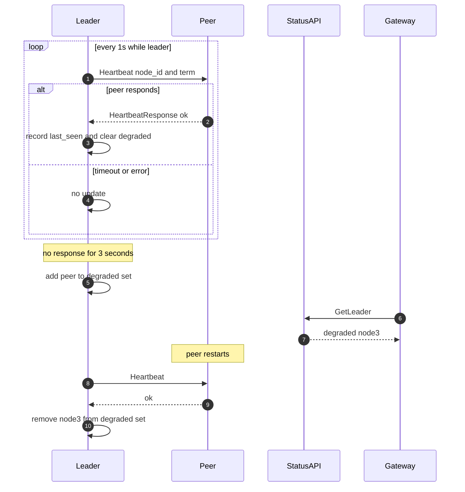
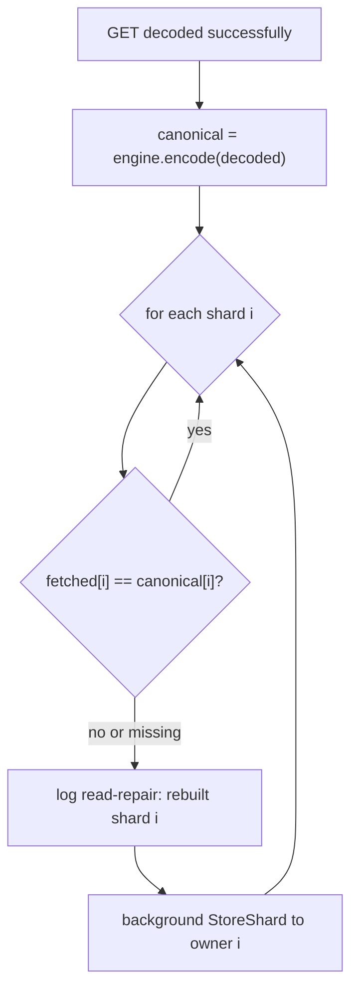
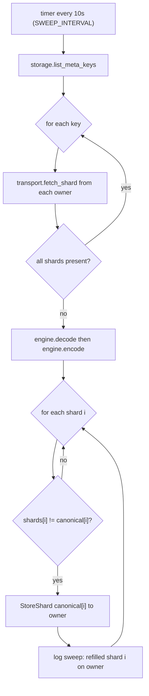
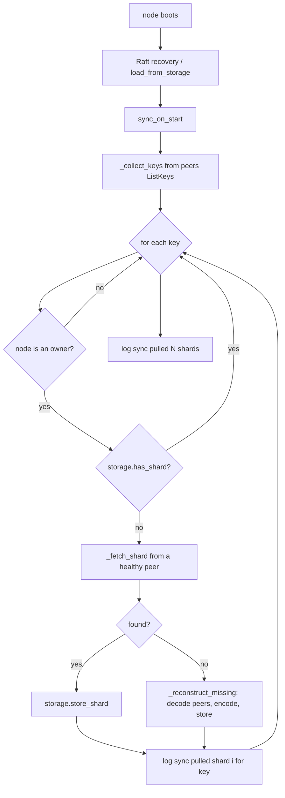
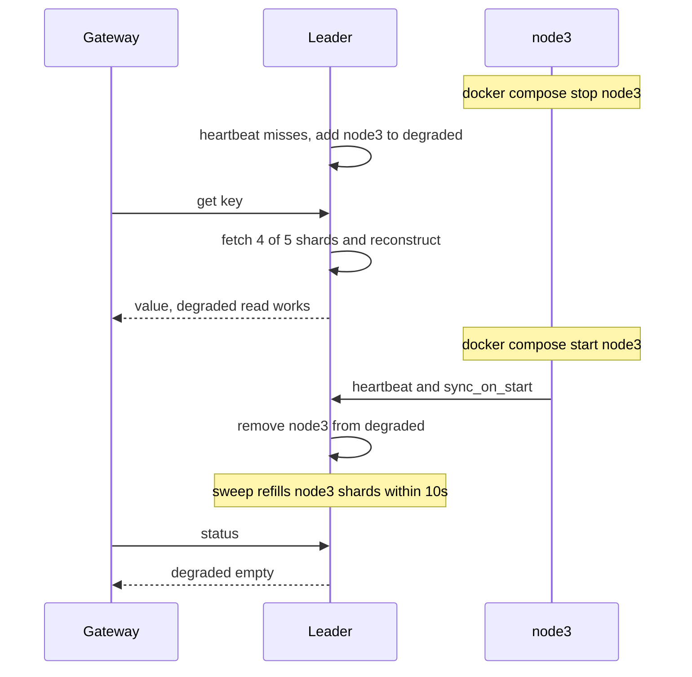

# Failure Management & Recovery

Maps to the proposal's **Failure Management & Recovery Subsystem** and the
course's **fault tolerance**, **reliability**, and **migration/load balancing**
principles.

Three cooperating mechanisms:

1. **Failure detection** — leader heartbeats peers, marks degraded after ~3s.
2. **Read repair** — GET rebuilds missing/corrupt shards it had to reconstruct.
3. **Repair sweep + startup sync** — periodic refill and boot-time catch-up.

## Failure detection

Code: `node/raft/failure_detector.py::RaftFailureDetector._detector_loop`,
`mark_degraded`, `clear_degraded`, `_resolve_peer_id`.
Exposure: `node/service.py::NodeService.GetLeader`, `Heartbeat`.

## Read repair

Code: `node/repair.py::read_repair`, called from
`node/service.py::NodeService.Get`.

## Repair sweep

Code: `node/repair.py::RepairSweeper.run`, `RepairSweeper.sweep_once`.
Started in `node/main.py::main` (daemon thread, `SWEEP_INTERVAL` env, default 10s).

## Startup sync

Code: `node/repair.py::sync_on_start`, `_collect_keys`, `_fetch_shard`,
`_reconstruct_missing`. Wired in `node/main.py::main` as a daemon thread after
Raft recovery.

## Recovery timeline (demo)

## Known limitations

- No degraded writes: PUT requires all 5 shard acks.
- No snapshot compaction: log replay grows with history.
- Orphan shards from failed writes are not garbage-collected.
- Sweep is periodic (10s), so repair is not instantaneous.

## Verified by

- `tests/test_failure_detection.py::test_degraded_on_peer_failure`
- `tests/test_failure_detection.py::test_node_stop_marks_degraded`
- `tests/test_sweep.py::test_sweep_refills_missing_shard`
- `tests/test_sweep.py::test_sweep_does_not_touch_healthy_shards`
- `tests/test_sync.py::test_sync_on_start_pulls_missing_shard`
- `tests/test_sync.py::test_sync_on_start_reconstructs_missing_shard`
- `scripts/smoke.sh` (kill 1, kill 2, restart)
