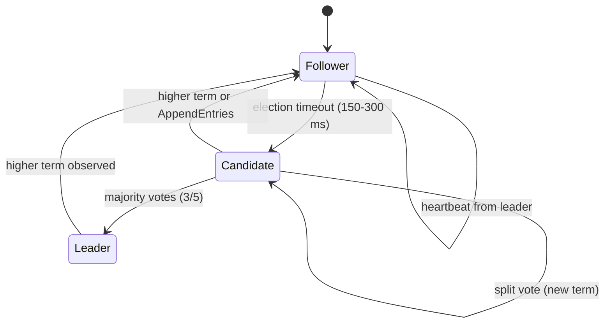
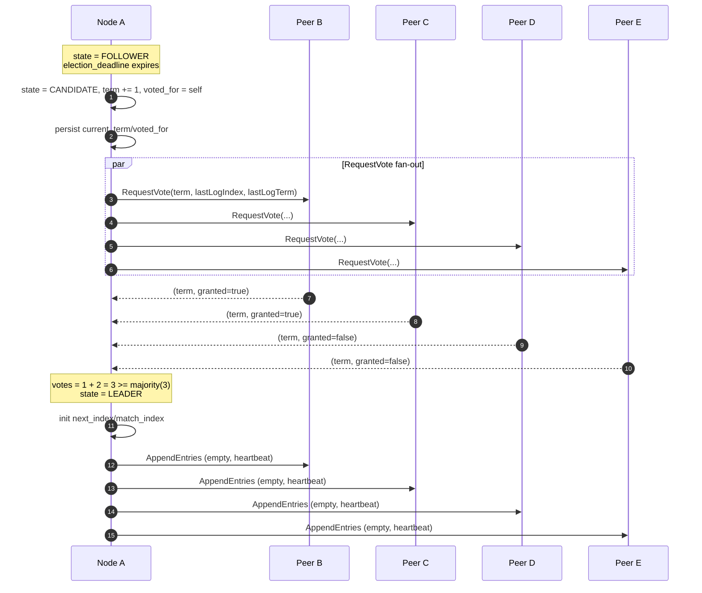
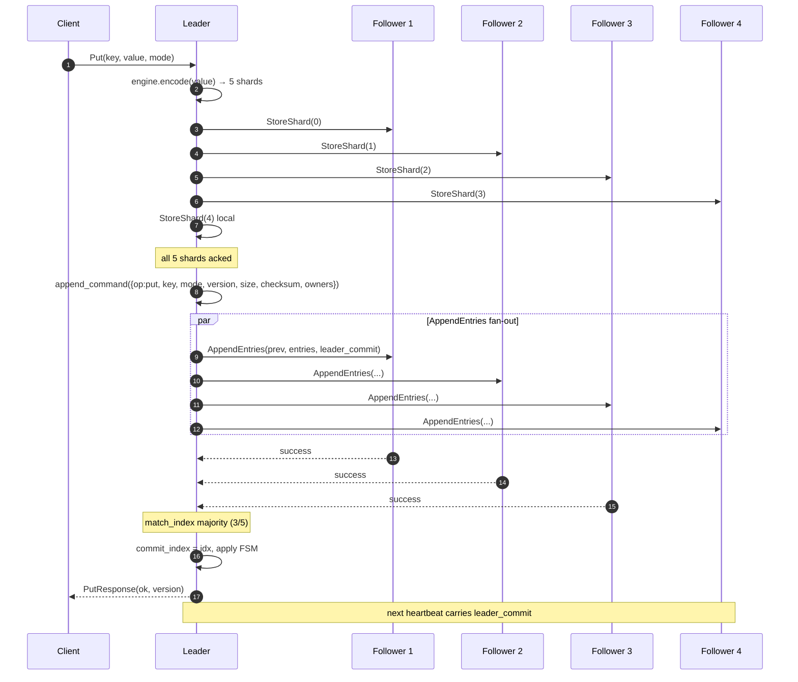
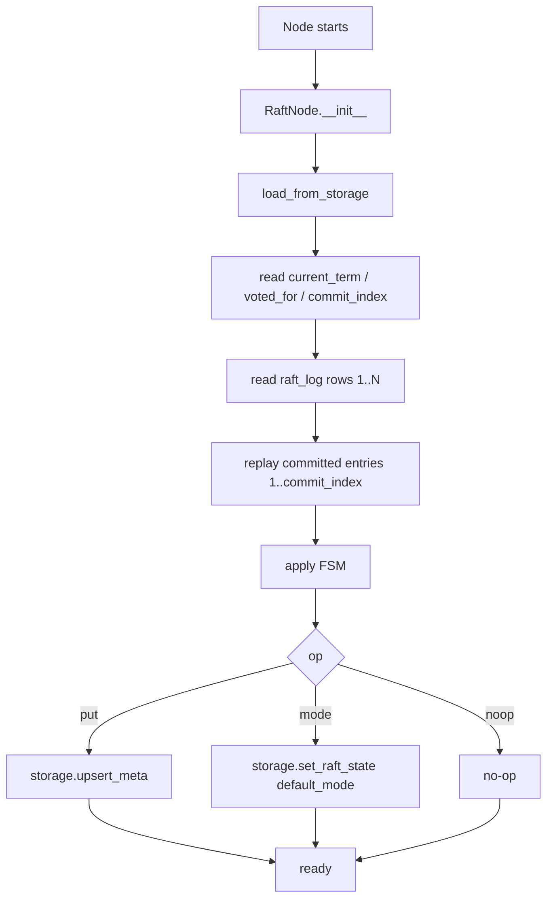

# Raft Consensus

Raft provides leader election, replicated log, and a deterministic state
machine. This maps to the proposal's **Raft Consensus Layer** and the course's
**reliability**, **concurrency**, and **fault tolerance** principles.

The implementation is split into mixins composed by `RaftNode`:

| Concern | File | Class |
|---|---|---|
| Facade | `node/raft/node.py` | `RaftNode` |
| Election | `node/raft/election.py` | `RaftElection` |
| Replication | `node/raft/replication.py` | `RaftReplication` |
| Persistence/FSM | `node/raft/persistence.py` | `RaftPersistence` |
| Failure detection | `node/raft/failure_detector.py` | `RaftFailureDetector` |
| In-process transport | `node/raft/direct_transport.py` | `DirectTransport` |

## State machine

## Leader election

Code: `node/raft/election.py::RaftElection._start_election`,
`handle_request_vote`, `_reset_election_timer`, `_run`. Majority formula:
`(len(peers) + 1) // 2 + 1`.

## Log replication and commit

Code: `node/raft/replication.py::RaftReplication.append_command`,
`_replicate_once`, `_advance_commit_index`; `handle_append_entries`.

## Persistence and FSM replay

Code: `node/raft/persistence.py::RaftPersistence.load_from_storage`,
`_replay_committed_locked`, `_default_apply`, `_apply_entry`,
`_persist_state`, `_persist_append`, `_persist_truncate`.

FSM command shape (JSON):
`{"op":"put","key":...,"mode":...,"version":...,"size":...,"checksum":...,"owners":[...]}`
or `{"op":"mode","mode":"rs32|replication"}`.

## Safety properties

- At most one leader per term (voted_for persisted).
- Commit requires a majority (3/5) of `match_index`.
- Followers truncate conflicting suffixes and reject mismatched
  `prev_log_index/term`.
- Higher terms force step-down.

## Verified by

- `tests/test_raft_election.py::test_election_converges_single_leader`
- `tests/test_raft_election.py::test_no_split_brain_sampled`
- `tests/test_raft_election.py::test_leader_failover`
- `tests/test_raft_replication.py::test_put_replicates_to_majority_and_commits`
- `tests/test_raft_replication.py::test_commit_requires_quorum`
- `tests/test_raft_persistence.py::test_replay_on_startup`
- `tests/test_raft_submodules.py::test_submodule_mixins_are_importable`
