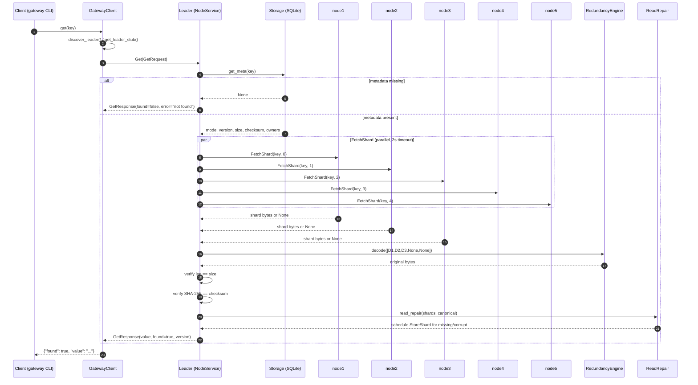

# Read Path (GET)

Maps to the proposal's **Redundancy & Encoding Engine** (reconstruction) and the
course's **fault tolerance** principle.

## Sequence

## Steps in code

| Step | Code |
|---|---|
| Leader lookup | `gateway/client.py::GatewayClient.get` → `call_with_retry` |
| RPC entry | `node/service.py::NodeService.Get` |
| Metadata lookup | `node/storage.py::Storage.get_meta` |
| Parallel fetch | `NodeService.Get::fetch_one` + `ThreadPoolExecutor` (2s) |
| Local fetch | `node/storage.py::Storage.fetch_shard` |
| Remote fetch | `node/transport.py::GrpcTransport.fetch_shard` |
| Decode | `node/encode.py::RS32Engine.decode` / `ReplicationEngine.decode` |
| Size check | `NodeService.Get` (`len(decoded) == size`) |
| Checksum check | `NodeService.Get` (`hashlib.sha256`) |
| Read repair | `node/repair.py::read_repair` (background `StoreShard`) |

## Reconstruction guarantees

- **RS(3,2):** any 3 of 5 shards reconstruct; up to 2 missing.
- **Replication:** any 1 of 5 copies reconstructs; up to 4 missing.
- Corrupt (same-length) RS shards are corrected by Reed-Solomon error
  correction (1 error) or treated as erasures when length differs.

## Read repair

After a successful decode, canonical shards are recomputed with
`engine.encode(decoded)` and compared with the fetched shards. Mismatched or
missing shards are re-`StoreShard`ed to their owner in a daemon thread; a log
line `read-repair: rebuilt shard i` is emitted.

## Verified by

- `tests/test_read_path.py::test_put_get_roundtrip[rs32]`
- `tests/test_read_path.py::test_put_get_roundtrip[replication]`
- `tests/test_read_path.py::test_corrupt_shard_reconstructs`
- `tests/test_read_path.py::test_missing_metadata_not_found`
- `tests/test_repair.py::test_read_repair_restores_corrupt_shard`
- `tests/test_repair.py::test_read_repair_log_line`
