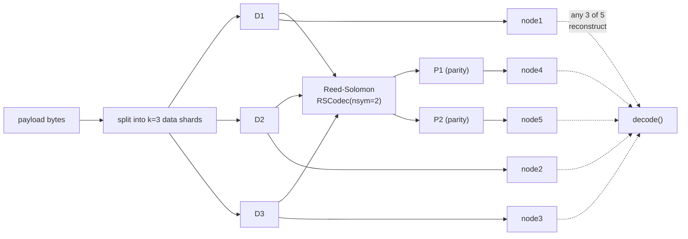
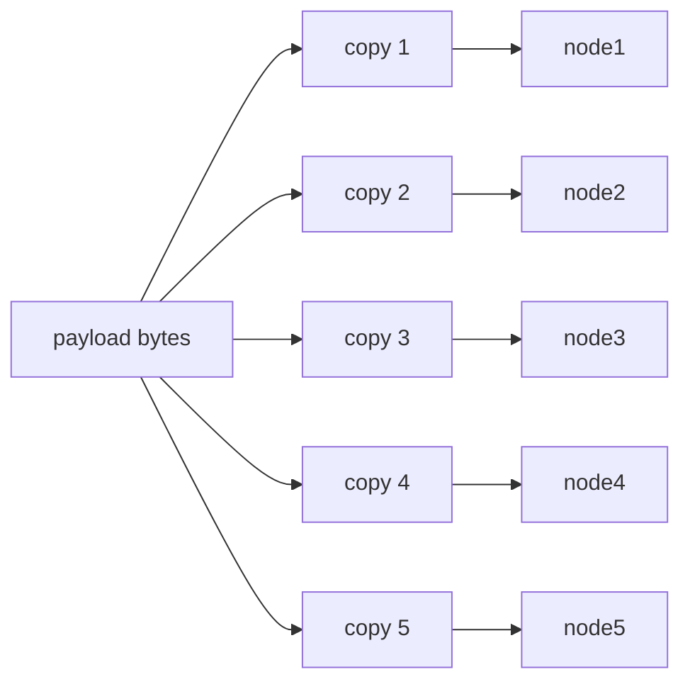
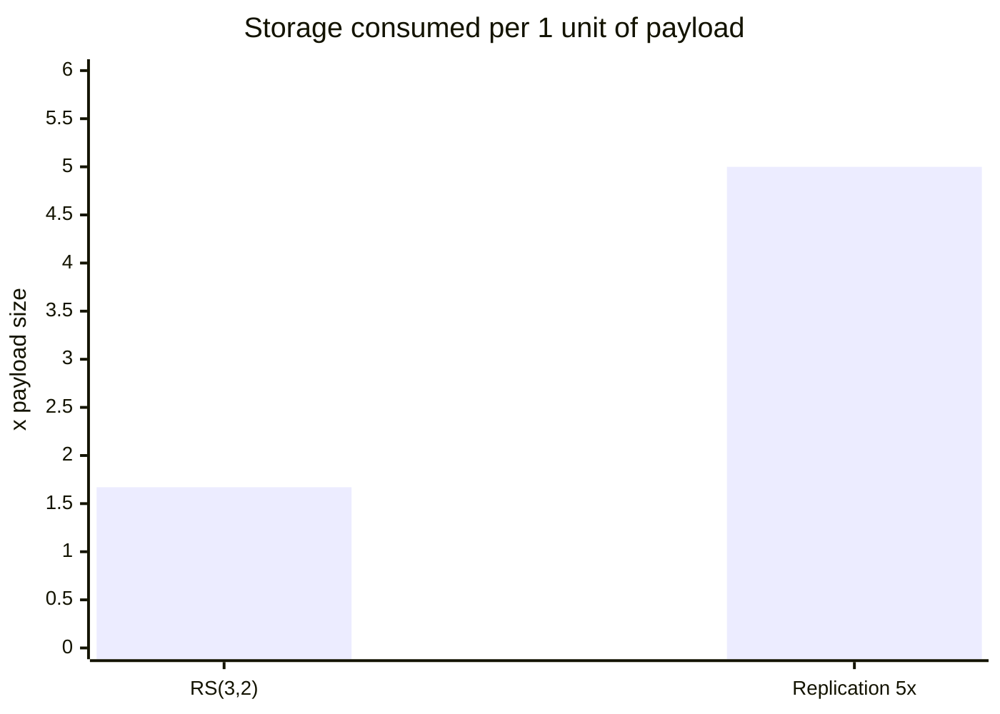
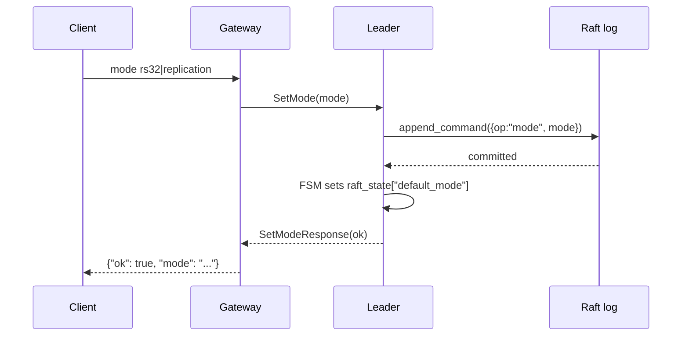

# Redundancy & Encoding

Maps to the proposal's **Redundancy & Encoding Engine** and the course's
**economy** and **reliability** principles. The system supports two runtime
modes, toggled via `gateway mode rs32|replication`.

## RS(3,2) erasure coding

- Survives **any 2 lost shards** (k=3).
- Tolerates **1 corrupt shard** via RS error correction.
- Storage overhead: **~1.67×** (5/3 of payload).

> **Placement is an example, not hardcoded.** The diagram shows the default
> naming where `owners = sorted(node ids)` and shard `i` is written to
> `owners[i]`. With ids `node1..node5` that puts data shards on node1–node3 and
> parity on node4–node5, but the mapping is derived from the sorted owner list
> (`node/service.py::NodeService.Put`), so it shifts if the node ids or order
> change. Parity is never pinned to specific nodes by shard type.

Code: `node/encode.py::RS32Engine.encode`, `decode`, `required()` → 3.

## 5× replication

- Survives **any 4 lost copies**.
- Storage overhead: **5.00×**.
- Fastest read path (any single shard is the full value).

Code: `node/encode.py::ReplicationEngine.encode`, `decode`, `required()` → 1.

## Economy comparison

| Mode | Shards | Overhead | Survives | Reconstruct from |
|---|---|---|---|---|
| RS(3,2) | 3 data + 2 parity | ~1.67× | 2 losses | any 3 |
| Replication | 5 copies | 5.00× | 4 losses | any 1 |

> Note: the proposal described 3× replication (200% overhead). The project was
> deliberately changed to **5×** so replication stores one copy per node,
> survives 4 losses, and makes the economy contrast sharper:
> **RS ~1.67× vs replication 5.00×**. The toggle still lets administrators
> benchmark both, which is the proposal's core adaptive claim.

## Runtime toggle

Code: `node/service.py::NodeService.SetMode`;
`node/raft/persistence.py::RaftPersistence._default_apply` (`op == "mode"`).

## Where the code lives

- Engines: `node/encode.py` (`RedundancyEngine`, `RS32Engine`,
  `ReplicationEngine`, `checksum`)
- Encode on write: `node/service.py::NodeService.Put`
- Decode on read: `node/service.py::NodeService.Get`
- Mode default: `Storage.get_raft_state("default_mode")`
- Mode override: `PutRequest.mode`

## Verified by

- `tests/test_encode.py::test_roundtrip[rs/repl, sizes]`
- `tests/test_encode.py::test_rs_drop_any_two`
- `tests/test_encode.py::test_rs_corrupt_one`
- `tests/test_encode.py::test_repl_survives_single_shard`
- `tests/test_read_path.py::test_put_get_roundtrip[rs32]`
- `tests/test_read_path.py::test_put_get_roundtrip[replication]`
