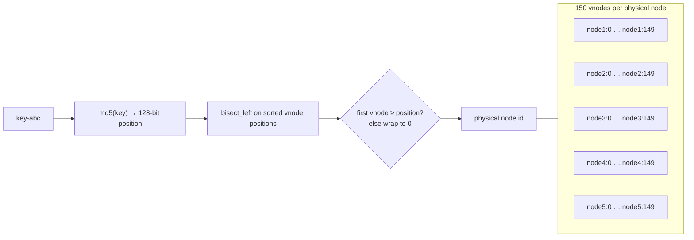
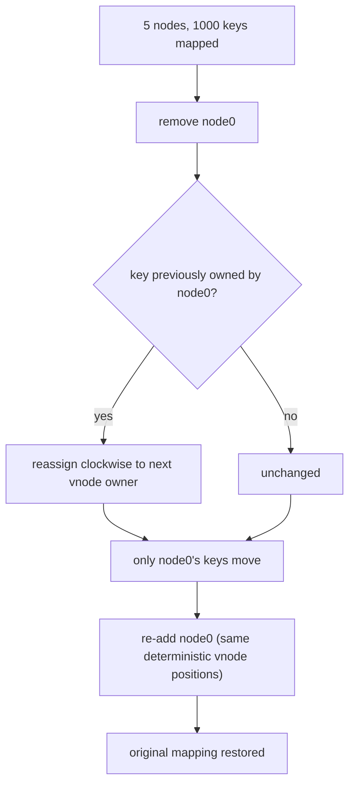

# Routing & Consistent Hashing

Maps to the proposal's **Client API Gateway & Router Module** and the course's
**migration/load balancing** and **transparency** principles.

## Two-layer routing

1. **Gateway → leader (actual client traffic).** The gateway discovers the Raft
   leader and sends `Put`/`Get` directly to it, retrying on failover.
2. **Consistent-hash ring (routing/migration demo).** A 150-vnode ring maps
   keys to physical nodes. This is retained for the rubric's
   migration/load-balancing bullet and for demonstrating minimal remap; it does
   not select the entry node for data traffic.

## Ring layout

## Minimal remap on membership change

## Where the code lives

- Ring: `gateway/ring.py::ConsistentHashRing` (`__init__` 150 vnodes,
  `add_node`, `remove_node`, `get_node`, `nodes`, `__len__`)
- Leader discovery/retry: `gateway/client.py::GatewayClient.discover_leader`,
  `get_leader_stub`, `call_with_retry`
- Leader id → address mapping: `gateway/client.py::_map_leader_to_addr`

## Distribution expectation

With 150 vnodes/node and MD5, each of 5 nodes receives roughly 20% of keys.
The test asserts 15–25% per node.

## Verified by

- `tests/test_ring.py::test_distribution_across_nodes`
- `tests/test_ring.py::test_minimal_remap_on_remove`
- `tests/test_ring.py::test_minimal_remap_any_victim`
- `tests/test_ring.py::test_readd_restores_mapping`
- `tests/test_gateway_leader.py::test_leader_failover_rediscovery`
