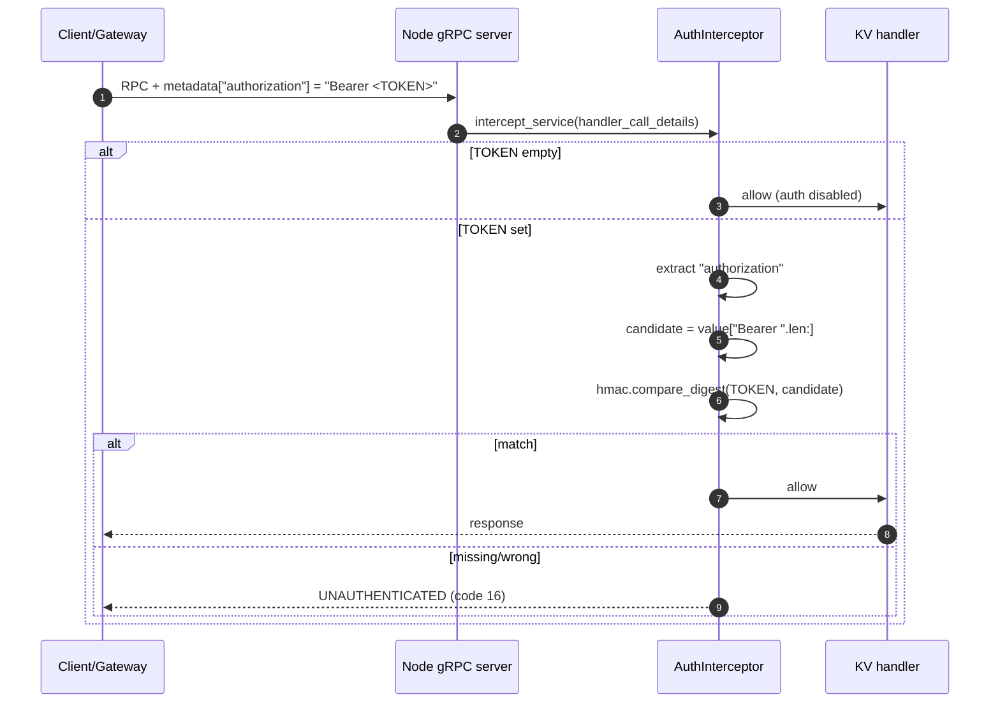

# Security

Maps to the course's **security** principle ("only authenticated and authorized
users are allowed to perform certain operations") and the proposal's
"structured gateway access boundaries". This is intentionally the **minimal**
mechanism from the MVP cut list: a shared bearer token, no user accounts/JWT.

## Threat model (scope)

- Protect the gRPC surface from unauthenticated clients/peers on the Docker
  network.
- Not covered: TLS, per-user identity, roles, key rotation, replay protection.

## Auth flow



## Configuration

- `TOKEN` environment variable on every service in `docker-compose.yml`
  (`${TOKEN:-}`). Empty/unset → auth disabled (backward compatible).
- Gateway and peer transport attach `authorization: Bearer <token>` to every
  RPC.

## Where the code lives

| Concern | Code |
|---|---|
| Server interceptor | `node/auth.py::AuthInterceptor`, `_get_token` |
| Server assembly | `node/server.py::serve` (installs `AuthInterceptor`) |
| Gateway metadata | `gateway/client.py::GatewayClient._metadata` |
| Peer metadata | `node/transport.py::GrpcTransport._auth_metadata` |
| Compose env | `docker-compose.yml` (`TOKEN: ${TOKEN:-}`) |
| Log redaction | `node/logging.py` (`REDACTED_FIELDS`, `_sanitize`) |

## No token leakage

- `node/logging.py` redacts `token`, `authorization`, `secret`, `payload`,
  `value` to `[REDACTED]`.
- gRPC metadata is not logged by the application.

## Demo commands

```sh
# Auth disabled (default)
docker compose up -d
docker compose run --rm gateway status

# Auth enabled
TOKEN=secret docker compose up -d
docker compose run --rm -e TOKEN=secret gateway status   # ok
docker compose run --rm gateway status                   # UNAUTHENTICATED
```

## Verified by

- `tests/test_auth.py::test_missing_token_rejected`
- `tests/test_auth.py::test_wrong_token_rejected`
- `tests/test_auth.py::test_correct_token_accepted`
- `tests/test_auth.py::test_no_auth_when_token_unset`
