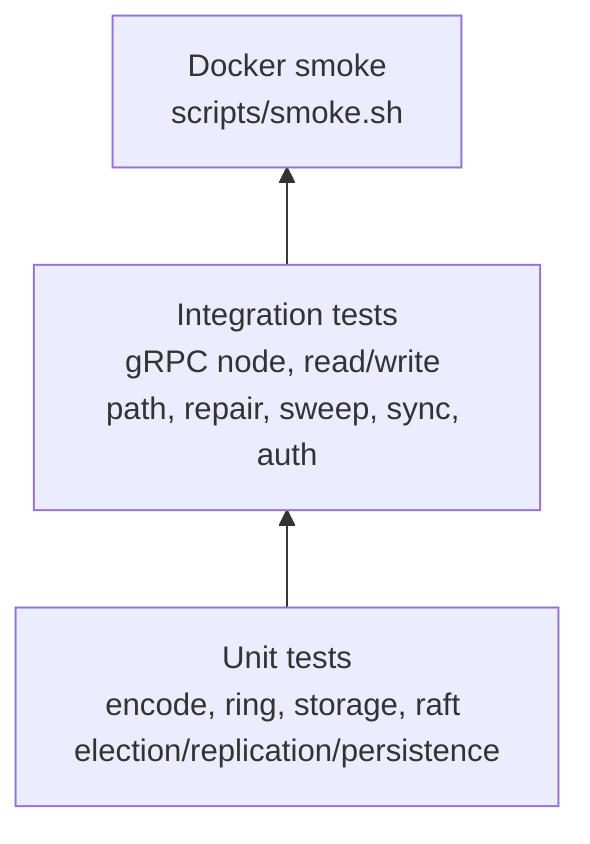

# Testing & Evaluation

Evidence for the **Project Code (25%)** and **demo (40%)** criteria:
functionality, reliability, and a reproducible evaluation.

## Test pyramid



## Commands

```sh
# Local (host Python 3.11+ with deps installed)
python -m pytest

# Container (Python 3.12, includes ruff + coverage gate)
docker compose run --rm node sh -c "ruff check . && pytest -q"

# End-to-end Docker smoke (< 60s)
bash scripts/smoke.sh

# Labeled demo
bash scripts/demo.sh

# Minimal put/get benchmark (p50/p95 + throughput)
python scripts/bench.py --keys 50 --value-size 1024
```

## Current results

| Metric | Value |
|---|---|
| Tests | 252+ passed |
| Coverage | 93.62% (gate threshold 90%) |
| Lint | `ruff check .` → All checks passed |
| Smoke | exit 0 |
| Cluster | 5/5 nodes healthy |

## What is covered

| Area | Tests |
|---|---|
| Erasure coding | `test_encode.py` (round-trip, drop-2, corrupt-1, replication) |
| Ring | `test_ring.py` (distribution, minimal remap, re-add) |
| Storage | `test_storage.py` (CRUD, reopen, concurrency, truncation) |
| Raft election | `test_raft_election.py` (single leader, failover, no split brain, step-down) |
| Raft replication | `test_raft_replication.py` (majority commit, backtracking, quorum, conflict) |
| Raft persistence/FSM | `test_raft_persistence.py` (round-trip, replay, mode op) |
| Node gRPC | `test_node_grpc.py` (StoreShard/FetchShard/HasShard) |
| Write path | `test_write_path.py` (shards per node, fail on node down) |
| Read path | `test_read_path.py` (both modes, corrupt shard, missing key) |
| Read repair | `test_repair.py` (restore + log line) |
| Sweep | `test_sweep.py` (refill, no corruption, stop) |
| Startup sync | `test_sync.py` (pull, skip present, reconstruct) |
| Failure detection | `test_failure_detection.py` (degraded + recovery) |
| Auth | `test_auth.py` (missing/wrong/correct/disabled) |
| Gateway | `test_gateway_leader.py` (failover rediscovery) |
| Submodules | `test_raft_submodules.py` (mixins importable) |
| Transport mapping | `test_transport_mapping.py` (node id → peer address) |

## Evaluation talking points

- **Performance:** Python throughput is lower than Go; acceptable for MVP/edge
  scale (documented trade-off). Writes are dominated by 5 shard RPCs; reads by
  parallel fetches.
- **Security:** shared token via metadata; constant-time compare; no token in
  logs.
- **Privacy:** logs redact payload/value/token; only metadata is logged.
- **Fault tolerance:** kill 1–2 nodes and reads still work (RS); restart and
  sweep/sync restore shards.
- **Economy:** RS ~1.67× vs replication 5.00×; runtime toggle.

## Known test gaps

- No chaos/failure-injection suite beyond `scripts/smoke.sh`.
- Benchmark harness is minimal and sequential; see [`BENCHMARKS.md`](BENCHMARKS.md).
- Coverage gate applies to `node/` and `gateway/` (generated `gen/` excluded).
