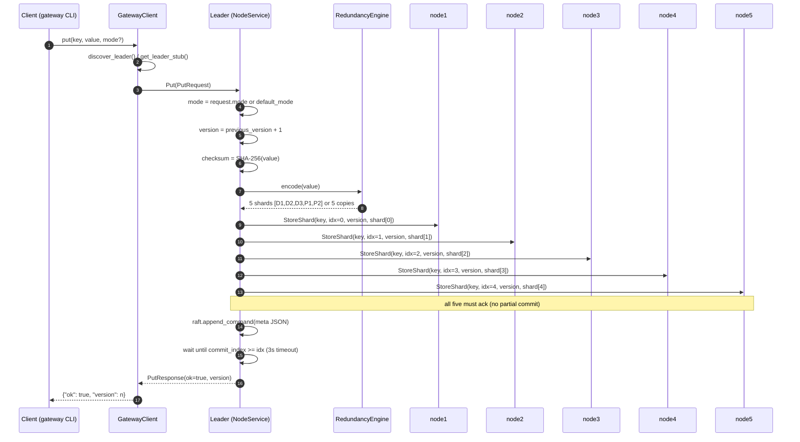

# Write Path (PUT)

Maps to the proposal's **Redundancy & Encoding Engine**, **Raft Consensus
Layer**, and the end-to-end PUT flow.

## Sequence

## Steps in code

| Step | Code |
|---|---|
| Discover leader | `gateway/client.py::GatewayClient.discover_leader`, `get_leader_stub` |
| Retry on failure | `gateway/client.py::GatewayClient.call_with_retry` |
| RPC entry | `node/service.py::NodeService.Put` |
| Mode selection | `NodeService.Put` (`request.mode` or `storage.get_raft_state("default_mode")`) |
| Version bump | `NodeService.Put` (reads `storage.get_meta(key)`) |
| Encode | `node/encode.py::RS32Engine.encode` / `ReplicationEngine.encode` |
| Parallel shard write | `NodeService.Put::_store_one` + `ThreadPoolExecutor` |
| Local shard | `node/storage.py::Storage.store_shard` |
| Remote shard | `node/transport.py::GrpcTransport.store_shard` |
| Raft append | `node/raft/replication.py::RaftReplication.append_command` |
| Commit wait | `NodeService.Put` (`commit_index >= idx`) |
| FSM apply | `node/raft/persistence.py::RaftPersistence._default_apply` (`op=put` → `upsert_meta`) |

## Failure behaviour

- If any `StoreShard` fails (node down), `Put` returns
  `{"ok": false, "error": "store shard failed"}` and **does not append** the
  Raft metadata entry → no partial commit.
- If the Raft commit does not advance within 3s, returns
  `{"ok": false, "error": "commit timeout"}`.
- Orphan shards from a failed write may remain locally; cleanup is out of MVP
  scope (documented limitation).

## Metadata stored (not payload)

`meta` row: `key, mode, version, size, checksum, owners`. Shard bytes live only
in the `shards` table on each node.

## Verified by

- `tests/test_write_path.py::test_put_then_inspect_shards`
- `tests/test_write_path.py::test_put_fails_cleanly_if_node_down`
- `tests/test_node_grpc.py::test_store_fetch_has_roundtrip`
- `scripts/smoke.sh` (put/get round-trip)
